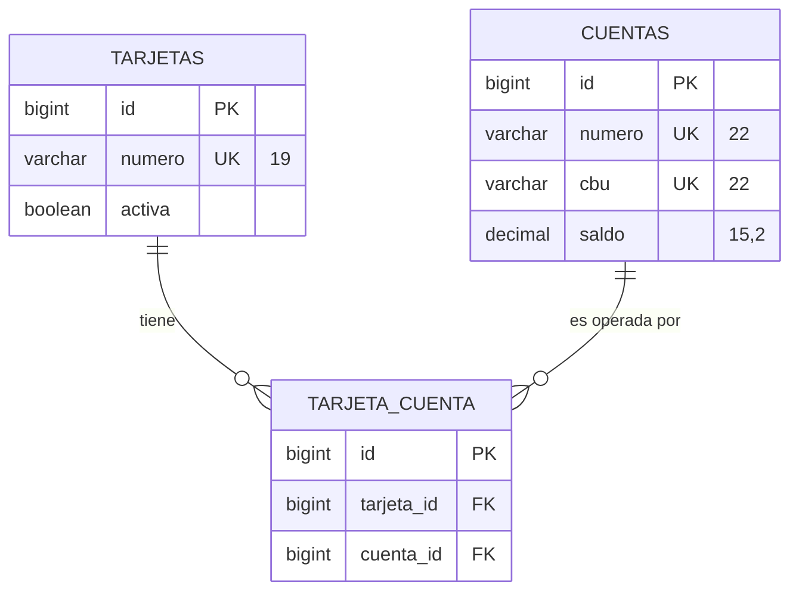

# Documento técnico – Producto ATM

Este documento explica las decisiones de diseño, cómo la implementación cumple los requisitos
funcionales y no funcionales del enunciado, y las concesiones tomadas por tiempo o por falta de
especificación.

Las instrucciones de instalación están en el [README](../README.md) y las pruebas, en
[EVIDENCIAS_PRUEBAS.md](EVIDENCIAS_PRUEBAS.md).

## 1. Visión general

La solución son dos proyectos Maven independientes en el mismo repositorio, como pide el enunciado:

- **`atm-service`**: microservicio REST en Spring Boot que expone las cuatro operaciones, persiste en
  H2 en memoria y deja un log transaccional en archivo.
- **`atm-console`**: aplicación de consola en Java 8 puro que recibe un comando por línea de
  comandos, llama al servicio por HTTP y muestra el resultado.

## 2. Microservicio (`atm-service`)

### 2.1 Tecnología

| Decisión | Motivo |
|---|---|
| Java 8 | Lo exige el enunciado. |
| Spring Boot 2.7.18 | Es la última línea de Spring Boot compatible con Java 8 (la 3.x requiere Java 17). Aporta servidor embebido, validación, JPA, transacciones y Actuator sin configuración extra. |
| H2 en memoria + `data.sql` | El enunciado permite persistir en memoria. H2 es una base relacional real: soporta transacciones y `SELECT ... FOR UPDATE`, que es lo que da la garantía de concurrencia. Cambiar a otra base solo requiere cambiar el datasource. |
| springdoc-openapi | Documenta la API en Swagger UI desde las anotaciones de los controllers. |
| Logback (incluido en Spring Boot) | Escribe el log transaccional en un archivo de texto con rotación, sin código propio de E/S. |
| JaCoCo (`jacoco-maven-plugin` 0.8.11) | Mide qué parte del código ejercitan los tests de `atm-service` y de `atm-console`. El reporte HTML se genera con `mvn clean verify` en `target/site/jacoco/index.html` de cada proyecto. Excluye del cálculo las clases de arranque y configuración (`AtmServiceApplication`; en la consola, `App` y los paquetes `client` y `config`) y el código que genera Lombok. No fija un umbral mínimo. Resultados en [las evidencias](EVIDENCIAS_PRUEBAS.md#24-cobertura-de-código-jacoco). |

### 2.2 Capas

El código se organiza en un estilo hexagonal liviano:

| Paquete | Responsabilidad |
|---|---|
| `domain.entity` | `Card`, `Account`, `CardAccount`. `Account` encapsula las reglas de saldo (`acreditar`, `debitar`). |
| `domain.exception` | Excepciones de negocio: `TarjetaNoEncontrada`, `TarjetaInactiva`, `CuentaNoEncontrada`, `SaldoInsuficiente`. |
| `domain.model.in` / `out` | Requests y responses de la API, con Bean Validation. |
| `app.service` (+ `impl`) | Un caso de uso por operación: `LoginService`, `BalanceService`, `ExtractService`, `DepositService`. Acá viven las transacciones. |
| `infra.in` | Controllers REST y `GlobalExceptionHandler`. |
| `infra.out` | Repositorios Spring Data JPA y `TransactionLogger`. |

Los controllers no tienen lógica: validan la entrada, llaman al servicio y arman la respuesta. Los
servicios dependen de interfaces, por lo que se prueban con Mockito sin levantar Spring.

### 2.3 Modelo de datos

El enunciado menciona una sección de "Entidades" que vino sin contenido, así que el modelo es propio:



- Una tarjeta de débito puede operar varias cuentas (Ana y Bruno tienen dos) y una cuenta podría
  estar asociada a varias tarjetas. Por eso la relación es N:M con la tabla `tarjeta_cuenta`
  (restricción única por par).
- Las cuentas tienen número de cuenta, usado en `extraer` y `saldo`, y CBU, usado en `depositar`,
  porque el enunciado identifica la cuenta de ambas formas.
- Los importes son `BigDecimal` con escala 2 (`DECIMAL(15,2)`), nunca `double`, para no perder
  precisión con dinero.

### 2.4 API

Todas las operaciones son `POST` con JSON:

| Operación | Endpoint | Request |
|---|---|---|
| login | `/api/login` | `cardNumber` |
| consultar_saldo | `/api/accounts/balance` | `cardNumber`, `accountNumber` |
| extraer | `/api/transactions/extract` | `cardNumber`, `accountNumber`, `amount` |
| depositar | `/api/transactions/deposit` | `cardNumber`, `cbu`, `amount` |

Se eligió `POST` también para login y saldo porque así el número de tarjeta viaja en el cuerpo y no
en la URL, que suele quedar registrada en logs de proxies y servidores.

### 2.5 Validación

La validación ocurre en tres niveles:

1. **Consola** (`AmountParser`): rechaza antes de llamar al servicio importes no numéricos,
   negativos, cero, con más de 2 decimales o con más de 13 dígitos enteros.
2. **API** (Bean Validation en los requests): campos obligatorios, `amount >= 0.01`, como máximo 13
   enteros y 2 decimales. Protege al servicio de otros clientes además de la consola.
3. **Dominio** (`Account.validarImporte`): un importe nulo o menor o igual a cero lanza
   `IllegalArgumentException`. Es la última barrera y no depende de cómo se llegue al método.

### 2.6 Manejo de errores

`GlobalExceptionHandler` traduce cada excepción a un código HTTP y un cuerpo uniforme
`{status, error, message, details, timestamp}`:

| Situación | Excepción | HTTP | `message` |
|---|---|---|---|
| Datos de entrada inválidos | `MethodArgumentNotValidException` | 400 | `Datos de entrada invalidos` (+ `details` por campo) |
| JSON mal formado | `HttpMessageNotReadableException` | 400 | `El cuerpo de la solicitud no es valido` |
| Importe no positivo (dominio) | `IllegalArgumentException` | 400 | `El importe debe ser mayor que cero` |
| Tarjeta inactiva | `TarjetaInactivaException` | 403 | `La tarjeta no esta activa` |
| Tarjeta inexistente (depósito) | `TarjetaNoEncontradaException` | 404 | `Tarjeta no encontrada` |
| Cuenta no asociada a la tarjeta / CBU inexistente | `CuentaNoEncontradaException` | 404 | `Cuenta no encontrada para la tarjeta indicada` |
| Método no permitido | `HttpRequestMethodNotSupportedException` | 405 | `Metodo HTTP no permitido para este recurso` |
| Content-Type distinto de JSON | `HttpMediaTypeNotSupportedException` | 415 | `Content-Type no soportado, se espera application/json` |
| Saldo insuficiente | `SaldoInsuficienteException` | 422 | `Saldo insuficiente` |
| No se obtuvo el bloqueo de la cuenta | `PessimisticLockingFailureException` | 503 | `El servicio esta ocupado, intente nuevamente` |
| Cualquier otro error | `Exception` | 500 | `Error interno del servicio` (la traza va solo al log del servidor) |

La consola muestra el `message` de la respuesta, así que los mensajes del servicio son los que ve el
usuario.

## 3. Aplicación de consola (`atm-console`)

| Decisión | Motivo |
|---|---|
| Java 8 sin framework | El enunciado pide Java 8 y una aplicación de consola simple. Solo se agregan Jackson (JSON) y Lombok (DTOs). |
| `HttpURLConnection` | Cliente HTTP del JDK 8; evita sumar una librería para cuatro llamadas POST. |
| Patrón Command + `CommandDispatcher` | Cada operación es una clase (`LoginCommand`, `ExtractCommand`, `DepositCommand`, `BalanceCommand`) con nombre, uso y cantidad de argumentos. El dispatcher valida los argumentos, ejecuta y traduce excepciones a mensajes y códigos de salida. Agregar una operación es agregar una clase. |
| Interfaz `AtmClient` | Los comandos dependen de la interfaz y no de HTTP, así que se prueban con mocks. `HttpAtmClient` se prueba contra un servidor HTTP embebido. |
| Fat JAR (maven-shade) + `atm.bat` | Se ejecuta como `atm <comando> ...`, que coincide con el `nombre_aplicación <comando>` del enunciado. |
| Sin estado entre comandos | Cada invocación es un proceso nuevo y vuelve a enviar la tarjeta. `login` solo verifica la tarjeta (ver concesiones). |
| Códigos de salida 0 / 1 | Permiten usar la consola desde scripts. Los errores van a stderr. |
| Timeouts | 3 s para conectar y 10 s para leer. Si el servicio no responde se muestra un mensaje claro en lugar de una traza. |
| Codificación de salida | `ConsolePrinter.forSystemStreams()` escribe con la página de códigos de la consola cuando Java 8 la soporta (por ejemplo `cp850`), y en UTF-8 si la consola está en UTF-8 (`cp65001`, que Java 8 no reconoce) o si la salida está redirigida. Así `Depósito exitoso` se ve bien en `cmd`. Se detectó y corrigió durante las pruebas ([hallazgo H1](EVIDENCIAS_PRUEBAS.md#hallazgos)). |
| Formato `$ 99999,99` | `AmountFormatter` usa coma decimal y 2 decimales, como el ejemplo del enunciado. |

Cada operación es una clase que implementa `Command`; los comandos dependen de la interfaz `AtmClient`, no de HTTP.



## 4. Cumplimiento de requisitos funcionales

### 4.1 Aplicación de consola

| Requisito | Implementación | Resultado en consola |
|---|---|---|
| 4 operaciones por línea de comando que consumen el servicio por HTTP | `CommandDispatcher` + 4 comandos + `HttpAtmClient` | — |
| **Identificarse** solo con la tarjeta: `login <tarjeta>` | `LoginCommand` → `POST /api/login` | `Ingreso exitoso` / `Ingreso no exitoso` |
| **Extraer**: `extraer <tarjeta> <cuenta> <importe>` | `ExtractCommand` → `POST /api/transactions/extract` | `Retire su dinero` o el mensaje de error (`Saldo insuficiente`, `La tarjeta no esta activa`, ...) |
| **Depositar** en una cuenta que puede o no ser del titular: `depositar <tarjeta> <cbu> <importe>` | `DepositCommand` → `POST /api/transactions/deposit`. La cuenta destino se busca solo por CBU. | `Depósito exitoso` o el mensaje de error |
| **Consultar saldo**: `saldo <tarjeta> <cuenta>` | `BalanceCommand` → `POST /api/accounts/balance` | `Su saldo es $ 99999,99` o el mensaje de error |

### 4.2 Microservicio

| Método | Regla del enunciado | Implementación |
|---|---|---|
| login | Verificar que la tarjeta exista y esté activa | `LoginServiceImpl`: devuelve `success=true` solo si la tarjeta existe y `activa = TRUE`. |
| extraer | Debitar si es posible; el saldo no puede ser negativo | `ExtractServiceImpl`: valida la asociación tarjeta-cuenta y que la tarjeta esté activa, bloquea la cuenta y llama a `Account.debitar`, que no debita si `saldo < importe`. Extraer el saldo exacto deja la cuenta en 0. |
| depositar | Acreditar en la cuenta del CBU si existe | `DepositServiceImpl`: valida que la tarjeta exista y esté activa, busca la cuenta por CBU (sin exigir que sea del titular), la bloquea y acredita. |
| consultar_saldo | Devolver el saldo si es posible | `BalanceServiceImpl`: devuelve el saldo si la cuenta está asociada a la tarjeta. Si no, 404. |

## 5. Cumplimiento de requisitos no funcionales

### 5.1 Servicio crítico

El enunciado indica que cualquier interrupción afectaría a la plataforma. Dentro del alcance del
desafío se priorizó que el servicio **no deje datos inconsistentes** y que **no se caiga ante
entradas inválidas**:

- **Atomicidad**: cada extracción y depósito corre en una única transacción (`@Transactional`). Si
  algo falla, no queda un débito o crédito a medias.
- **Concurrencia**: antes de modificar el saldo se toma un bloqueo pesimista de la fila
  (`SELECT ... FOR UPDATE`, `AccountRepository.findByIdForUpdate` / `findByCbuForUpdate`). Las
  operaciones simultáneas sobre la misma cuenta se ejecutan en serie y no se pierden actualizaciones.
  `TransactionConcurrencyTest` lo verifica con 8 hilos en paralelo contra H2 real.
- **Saldo nunca negativo**: la regla vive en la entidad (`Account.debitar`) y se evalúa con la fila
  bloqueada, así que dos extracciones concurrentes no pueden superar el saldo entre las dos.
- **Errores controlados**: toda excepción se traduce a una respuesta JSON con código HTTP adecuado.
  Los errores inesperados devuelven 500 sin exponer la traza.
- **Contención**: si no se obtiene el bloqueo dentro del tiempo de espera de la base, se responde
  503 (`El servicio esta ocupado, intente nuevamente`) en lugar de dejar la petición colgada.
- **Monitoreo**: Spring Boot Actuator expone `/actuator/health` para chequeos de disponibilidad.
- **Cliente resiliente**: la consola tiene timeouts y, si el servicio no está disponible, informa
  `No se pudo conectar con el servicio ATM en <url>` con código de salida 1.

La alta disponibilidad real (varias instancias, base persistente compartida) queda fuera del alcance;
ver concesiones.

### 5.2 Trazabilidad y auditoría

El servicio deja un **log transaccional en archivo de texto** con un formato propio, pensado para
leerse a simple vista y procesarse con herramientas de texto:

```
<fecha y hora con milisegundos> | tipo=<TIPO> tarjeta=****NNNN cuenta=<cuenta o CBU> importe=<importe> resultado=<RESULTADO>
```

| Campo | Valores |
|---|---|
| `tipo` | `LOGIN`, `EXTRACCION`, `DEPOSITO` |
| `tarjeta` | Últimos 4 dígitos; el número completo nunca se escribe |
| `cuenta` | Número de cuenta (extracción) o CBU destino (depósito) |
| `importe` | Con 2 decimales |
| `resultado` | `OK`, `RECHAZADA(<causa>)`, o `EXITOSO` / `NO_EXITOSO` para login |

Ejemplo real de la corrida de pruebas:

```
2026-10-22 01:06:15.049 | tipo=EXTRACCION tarjeta=****3333 cuenta=0000000001 importe=300.00 resultado=OK
2026-10-22 01:06:15.820 | tipo=EXTRACCION tarjeta=****3333 cuenta=0000000001 importe=5000.00 resultado=RECHAZADA(SaldoInsuficienteException)
2026-10-22 01:06:19.976 | tipo=DEPOSITO tarjeta=****3333 cuenta=0170000000000000000002 importe=100.00 resultado=OK
2026-10-22 01:06:20.768 | tipo=DEPOSITO tarjeta=****7777 cuenta=0170000000000000000001 importe=100.00 resultado=RECHAZADA(TarjetaInactivaException)
```

Decisiones:

- **Se registran también los rechazos** con su causa. Para auditar no alcanza con lo que se movió:
  hay que poder explicar qué se intentó y por qué no se hizo.
- **Tarjeta enmascarada**: el log identifica la operación sin exponer el número completo.
- **Archivo dedicado** (`logs/transacciones.log`) mediante un logger `TRANSACCIONES` con
  `additivity=false`, separado del log técnico de la aplicación.
- **Rotación diaria** (`transacciones.AAAA-MM-DD.log`) con 90 días de historial.
- El log sobrevive a reinicios del servicio, a diferencia de los saldos en H2.

## 6. Concesiones y decisiones ante falta de especificación

| Tema | Decisión tomada | Motivo / impacto |
|---|---|---|
| **Autenticación** | No hay PIN ni token: la identificación es solo con el número de tarjeta. | El enunciado pide identificarse "sólo con el número de tarjeta de débito". En un cajero real se exigiría PIN. |
| **`login` sin sesión** | `login` verifica la tarjeta, pero las otras operaciones no requieren haber hecho login antes. Cada una vuelve a validar la tarjeta. | Cada comando es un proceso independiente, como en el enunciado. Mantener sesión requeriría tokens y almacenamiento local, fuera de alcance. |
| **Saldo: tarjeta o tarjeta + cuenta** | Se pide `<tarjeta> <cuenta>`. | El texto dice "sólo con el número de tarjeta", pero el modo de uso incluye `<cuenta>`. Como una tarjeta puede tener varias cuentas, se siguió el modo de uso. |
| **Saldo con tarjeta inactiva** | Está permitido (Carla obtiene `Su saldo es $ 0,00`). | Decisión de negocio: es una consulta que no mueve dinero. Extraer y depositar sí rechazan la tarjeta inactiva. |
| **Saldo fuera del log** | La consulta de saldo no se registra en el log transaccional. | El requisito apunta a auditar saldos, y la consulta no los modifica. |
| **Login no distingue el motivo** | Tarjeta inexistente o inactiva dan el mismo `Ingreso no exitoso`. | Lo pide el enunciado, y además no revela qué tarjetas existen. Cada intento fallido queda en el log como `NO_EXITOSO` con la tarjeta enmascarada. |
| **Mensajes de "no encontrado"** | Depositar con tarjeta inexistente responde `Tarjeta no encontrada`; extraer y saldo responden `Cuenta no encontrada para la tarjeta indicada`. El CBU inexistente también responde `Cuenta no encontrada para la tarjeta indicada`. | Extraer y saldo validan el par tarjeta-cuenta en una sola consulta, así que no distinguen cuál falta. En el depósito por CBU el mensaje es confuso, porque no hay relación tarjeta-cuenta. Queda como mejora (sección 7). |
| **Validaciones en la consola fuera del log** | Los importes que rechaza la consola (cero, negativos, texto, más de 2 decimales) no llegan al servicio y por lo tanto no se registran. | Evita llamadas inútiles. El servicio vuelve a validar y responde 400 si otro cliente envía esos datos. |
| **Persistencia en memoria** | H2 en memoria con datos fijos en `data.sql`; los saldos vuelven al estado inicial al reiniciar. | Permitido por el enunciado. El log transaccional sí persiste. |
| **Log y commit** | La línea `OK` se escribe dentro de la transacción, antes del commit. | Si el commit fallara después de escribir, el log mostraría `OK` para una operación revertida. Es muy improbable con H2 embebida; con una base externa convendría registrar después del commit o usar una tabla de movimientos. |
| **Sin límites operativos** | No hay tope diario ni por extracción, más allá del formato del importe (máximo 13 enteros y 2 decimales). | No lo especifica el enunciado. |
| **Una sola instancia** | El bloqueo pesimista garantiza consistencia dentro de una base; no hay réplicas ni balanceo. | La alta disponibilidad real necesita infraestructura fuera del alcance de un servicio en localhost. |

## 7. Mejoras propuestas

- **Base persistente** (PostgreSQL, por ejemplo) y una **tabla de movimientos** como ledger contable,
  escrita en la misma transacción que el saldo. El archivo de texto quedaría como copia de auditoría.
- **Idempotencia y protección contra operaciones duplicadas**. Hoy cada llamada a `extraer` o
  `depositar` se procesa como una operación nueva, así que un reintento o un comando repetido por
  error mueve dinero dos veces. Se proponen dos mecanismos complementarios:
  - *Clave de idempotencia*: la consola genera un identificador único por operación y lo envía en un
    header (`Idempotency-Key`), reutilizándolo si reintenta por timeout o corte de red. El servicio
    guarda la clave junto con el resultado, en la misma transacción que el movimiento, y ante una
    clave repetida devuelve la respuesta original sin volver a debitar o acreditar. Cubre los
    reintentos automáticos.
  - *Detección de duplicados*: como cada ejecución de la consola es un proceso nuevo, un comando
    repetido por error llega con otra clave. Para ese caso, el servicio rechazaría (o pediría
    confirmar) una operación idéntica (misma tarjeta, cuenta o CBU e importe) dentro de una ventana
    corta configurable, y lo registraría en el log como `RECHAZADA(OperacionDuplicada)`.
    Alternativamente, la consola podría pedir confirmación antes de operar.
- **Autenticación** con PIN y token de sesión de corta duración, y HTTPS.
- **Mensajes de error** más precisos: separar tarjeta inexistente, cuenta no asociada y CBU
  inexistente.
- **Límites operativos** configurables (extracción máxima diaria, por operación).
